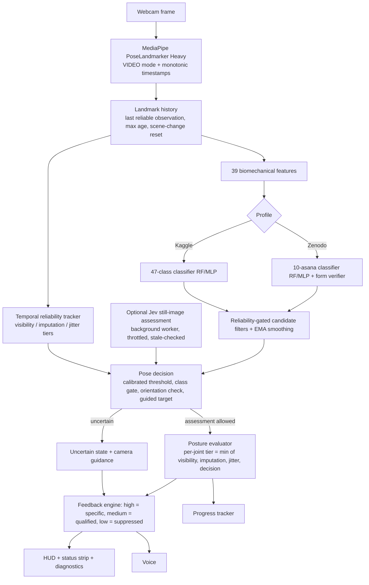

# Yoga Mitra: Real-Time Personalized Yoga Posture Detection and Correction

YogaMitra watches you through a webcam and does three things:
1. Recognizes the yoga pose you are in.
2. Checks your form.
3. Gives joint-level corrections on screen and by voice, but only when the measurements behind them are reliable.

Measured performance and its limitations are documented in **[EVALUATION.md](EVALUATION.md)**.

---

## Architecture



**Design guarantees**
- **Pose-specific corrections only from reliable evidence.** In auto-detect mode a label must pass all four checks below, otherwise the screen shows *uncertain* plus camera guidance:
  - the validation-calibrated confidence threshold;
  - a per-class reliability gate;
  - an orientation consistency check;
  - a two-inference stability check.
- **Guided mode keeps your chosen target.** Classification can only lower certainty in guided mode, never replace the target.
- **Joint-level evidence.** A correction is never issued for an angle whose joints are hidden or expired.
  - Estimated (carried-forward) joints are flagged and capped at "medium" reliability.
  - Medium-reliability corrections are worded as qualified suggestions.
- **Jev is optional.** It is an image-based second opinion on *which* asana is shown. It never supplies joint angles and never overrides a confident local prediction. The app is fully functional without it.
- **Everything is configurable** in `config.yaml`. Settings were chosen from validation data; see EVALUATION.md §3–§5.

---

## Installation

**Requirements:** Python **3.10–3.12** (tested on 3.12), a webcam, and about 1.5 GB of disk.

```bash
git clone https://github.com/anshu-0132/yogmitra && cd yogmitra
python -m venv .venv
# Windows: .venv\Scripts\activate    macOS/Linux: source .venv/bin/activate
pip install -r requirements.txt
# optional — only for the Kaggle 47-class *MLP* (Keras) model:
pip install -r requirements-optional.txt
# Linux only, for voice output:
sudo apt install espeak-ng
```

- `scikit-learn` is pinned to **1.9.0** because the saved `.joblib` models were created with it.
- On a headless Linux server, MediaPipe additionally needs `libegl1 libgles2` (`apt install libegl1 libgles2`).

### Required artifacts (already in the repository)

| File / folder | Purpose |
|---|---|
| `pose_landmarker_heavy (1).task` | MediaPipe PoseLandmarker Heavy model |
| `saved_yoga_model_zenodo/rf/`, `saved_yoga_model_zenodo/mlp/` | Zenodo 10-asana classifier + form verifier, per architecture. The un-suffixed folder is a copy of the MLP "champion"; the app loads `<dir>/<active_classifier>/`. |
| `saved_yoga_model/` | Kaggle 47-class RF (`.joblib`) and MLP (`.keras`) |
| `data/zenodo/*.csv`, `zenodo_yoga_landmarks - ….csv` | Zenodo features / landmarks used by the evaluation scripts |
| `data/zenodo/confidence_calibration.json` | Thresholds and per-class reliability, calibrated on the validation split |
| `assets/pose_references/` | Reference images for the right-hand panel |

All paths in `config.yaml` are resolved relative to the project root, so you can launch from any directory.

---

## Running

```bash
python run_app.py                                    # profile/classifier from config.yaml (Zenodo, RF, auto-detect)
python run_app.py --target-pose "Tadasana"           # guided practice
python run_app.py --free                             # auto-detect
python run_app.py --profile kaggle                   # 47-class Kaggle model
python run_app.py --classifier mlp                   # MLP instead of RF
python run_app.py --diagnostics                      # live diagnostic panel
python run_app.py --no-voice --camera 1
python run_app.py --calibrate                        # 5-second body calibration on start
python run_app.py --progress | --history | --test-voice
```

**Replaying a recorded video** works without a webcam, for demos and automated checks:

```bash
python run_app.py --video practice.mp4 --headless --no-voice --log-decisions decisions.jsonl
```

`decisions.jsonl` gets one line per inference. Each line records:
- the local prediction and its top 3;
- the landmark tier and the filter decision;
- the final decision and the reason for it;
- the corrections issued or suppressed, with the feedback text;
- latencies.

Use it to review false-correction rates on your own recordings.

### Keyboard controls

| Key | Action |
|:---:|:---|
| `T` / `N` | Cycle guided target pose |
| `M` | Toggle guided / auto-detect |
| `C` | Start or cancel calibration |
| `J` | Ask Jev to assess the current frame (only when Jev is enabled) |
| `D` | Toggle the diagnostics panel |
| `V` | Voice on/off |
| `A` | Joint-angle labels on/off |
| `+` / `-` | Inference interval |
| `R` | Reset prediction, landmark and reliability history |
| `S` | Screenshot to `screenshots/` |
| `Q` / `Esc` | Quit (camera, MediaPipe, Jev worker and voice are always released) |

### What the screen shows

- **HUD header:** `DETECTED: <pose>` only when an assessment is allowed. Otherwise it shows `POSE UNCERTAIN (best guess …)`.
- **Status strip** (bottom): `Local: <pose> <conf> | Jev: <pose> <conf> (<agree/disagree/…>) | Landmarks: HIGH/MEDIUM/LOW | Correction: issued / qualified / suppressed`, plus a `Why:` line whenever certainty is not high.
- **Skeleton:**
  - Solid dots are observed joints.
  - Hollow orange circles are joints estimated from the last few hundred milliseconds.
  - Expired or unseen joints are not drawn.
- **Diagnostics** (`D`):
  - FPS and MediaPipe / classifier latency;
  - counts of imputed, unavailable and suspect landmarks;
  - top-3 classes and the filter decision;
  - the final decision, Jev request statistics, and per-joint reliability tiers.

---

## Jev setup (optional, experimental)

Jev is TypeSafe's System One decision model ([docs.typesafe.ai](https://docs.typesafe.ai/)). YogaMitra uses its image input, `POST https://api.typesafe.ai/v1/systemone` with `model: "jev-preview"` and the `TypeSafe-Danger-Zone-Images: true` header, to ask "which of these asanas is shown?" for **selected still frames only**.

1. Get an API key from the TypeSafe console ([console.typesafe.ai/keys](https://console.typesafe.ai/keys)).
2. Put it in the environment, **never** in `config.yaml`:
   ```bash
   export JEVMODEL_API_KEY="..."            # Windows PowerShell: $env:JEVMODEL_API_KEY="..."
   ```
3. Enable Jev with `jev.enabled: true` in `config.yaml`, or pass `--jev`.
4. Check the `jev:` block in `config.yaml`:
   - endpoint and model;
   - timeout and retry count;
   - minimum request interval (default 6 s);
   - JPEG quality and maximum image side;
   - minimum confidence and maximum result age;
   - automatic request after `ambiguity_inferences` uncertain inferences;
   - manual `J` key;
   - optional form question;
   - the image opt-in header named in the docs.

**When frames are sent:**
- automatically, when auto-detect stays ambiguous for several inferences while tracking is good;
- or when you press `J`.

At most one request is in flight, and requests are throttled. An answer is discarded if the person moved, the scene changed, or the answer is older than `max_result_age_seconds`.

**Privacy:**
- Frames are sent to an external service only when Jev is enabled. The app prints a notice at start.
- Frames are not saved to disk.
- The key is never logged or displayed.

**Without a key** (or with `--no-jev`), the app runs fully local.

**Status:**
- The client is tested against mocked responses only.
- It has **not** been verified against the live API from the development environment.
- Run `python scripts/evaluate_jev_images.py --images-dir <labelled photos> --jev` before relying on Jev results.

---

## Tests and evaluation

```bash
python -m pytest tests/ -q          # 128 tests, no webcam, no network, no API key needed
```

| Test file | Covers |
|---|---|
| `tests/test_pipeline.py`, `tests/test_zenodo_pipeline.py` | Original suites |
| `tests/test_landmark_tracking.py` | Video timestamps, landmark history (one-frame / persistent occlusion, recovery, expiry, resets, visibility-decay ghosts) |
| `tests/test_reliability_fixes.py` | Confidence gating, filter behaviour and orientation transitions, guided-target preservation, tiered corrections, artifact / schema compatibility, cwd independence |
| `tests/test_jev_integration.py` | Request schema, parsing, failures / timeouts, retries, throttling, stale answers, fusion policy (all HTTP mocked) |

Evaluation scripts (see EVALUATION.md for results):

```bash
python scripts/evaluate_zenodo_models.py       # bare RF/MLP metrics on the held-out test split
python scripts/evaluate_runtime_pipeline.py    # filter ablation, smoothing, transitions, missing-landmark study
python scripts/calibrate_confidence.py         # thresholds & filter policy chosen on val, confirmed on test
python scripts/evaluate_system.py              # Kaggle 47-class
python scripts/test_step_by_step_system.py     # per-step accuracy on held-out sessions
python scripts/benchmark_mediapipe_modes.py --video clip.mp4 --still person.jpg
python scripts/evaluate_jev_images.py --images-dir labelled/ [--jev]
```

---

## Manual webcam verification checklist

Run `python run_app.py --diagnostics` with good lighting, the full body in view, and 2–3 m from the camera.

1. **Tracking:** stand still. The skeleton is steady, and diagnostics show `MediaPipe (video)` with FPS ≥ 10.
2. **Occlusion:** briefly hide one leg behind a chair (under 0.3 s).
   - Hollow markers should appear.
   - With longer occlusion the joint disappears, its angle checks become "unavailable", and no correction is given for it.
3. **Person leaves frame:** the screen shows "No person detected". When you come back, there are no stale corrections.
4. **Auto-detect, Tadasana:** expect `DETECTED: Tadasana` within about 1 s, with tier HIGH or MEDIUM. Bend one knee: a knee correction is issued and spoken after it persists.
5. **Auto-detect, an unsupported pose** (e.g. Warrior II): expect `POSE UNCERTAIN`, `Correction: suppressed`, and no joint corrections.
6. **Auto-detect, Sarvangasana / Vajrasana / Viparita Karani:** expect *uncertain*, a known model limitation. Switch to guided mode for these.
7. **Guided mode** (`T` to choose, `M` to toggle): the target stays fixed whatever pose the classifier sees. Corrections refer to the target.
8. **Poor camera:** step half out of the frame or dim the lights. Expect `Landmarks: LOW`, camera guidance, and no specific corrections.
9. **Jev**, if you have a key (`--jev`):
   - Hold an ambiguous pose. After about 1.5 s the diagnostics show `Jev: req=1`.
   - The status strip shows agree / disagree.
   - Press `J` repeatedly: one request at a time, and the app never freezes.
   - Unplug the network: the app continues local-only and the status shows `network_error` or `timeout`.
10. **Exit with `Q`:** the session summary prints and the camera light turns off.

---

## Supported asanas

- **Zenodo (10):** Tadasana, Kati Chakrasana, Ardhakati Chakrasana, Vajrasana, Parvatasana, Bhujangasana, Marjariasana, Sarvangasana, Viparita Karani, Anantasana.
- **Kaggle (47 classes):** guided reference poses are Virabhadrasana One and Two, Utkatasana, Trikonasana, Phalakasana, Adho Mukha Svanasana, and Vrksasana.

## Zenodo data and model pipeline

```bash
python scripts/prepare_zenodo_dataset.py                                     # features + group-aware splits
python scripts/train_zenodo_models.py --dry-run                              # validation only
python scripts/train_zenodo_models.py --execute-training-approved --model-type both --out-dir saved_yoga_model_zenodo_candidates/v2
```

Train into a **new** directory and compare against the originals with `evaluate_zenodo_models.py --model-dir <dir>` before switching. Never overwrite the shipped artifacts.
